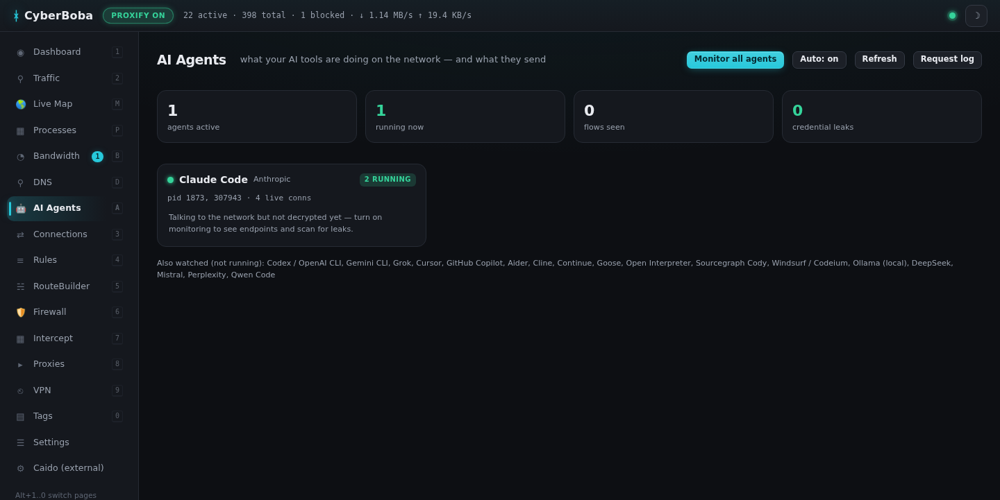
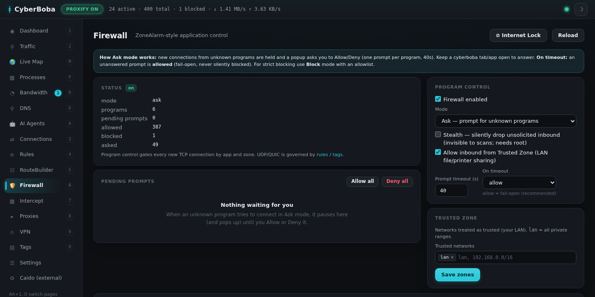
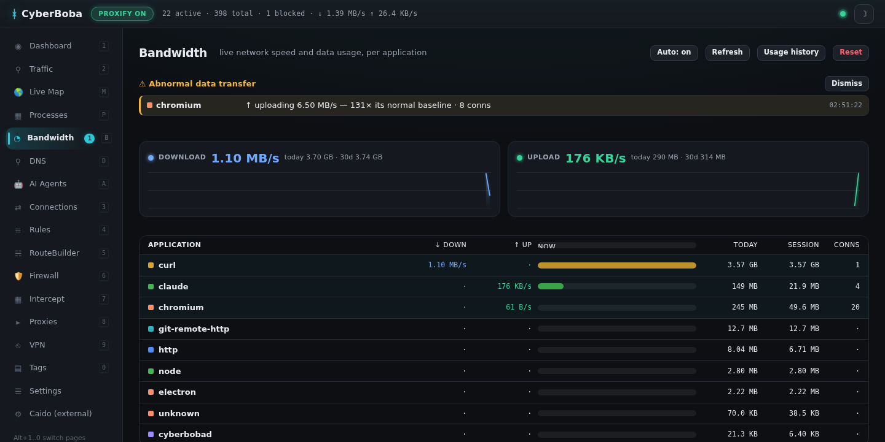
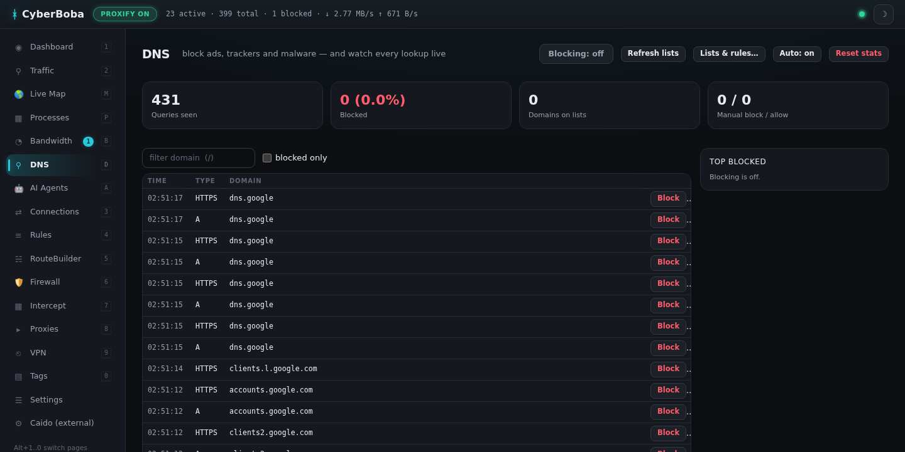
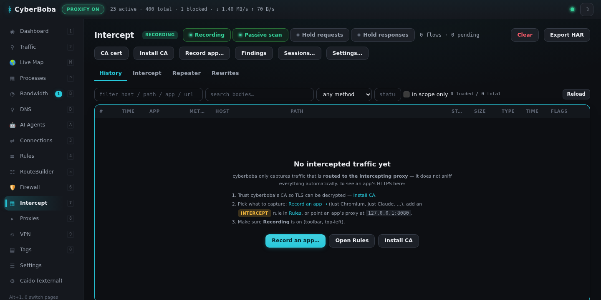
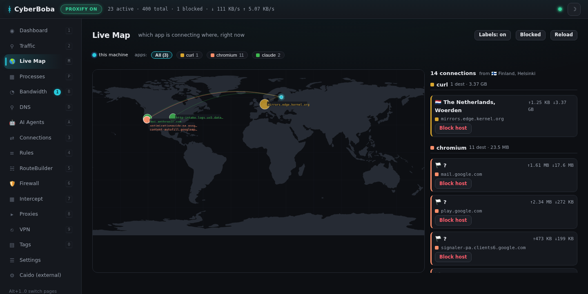
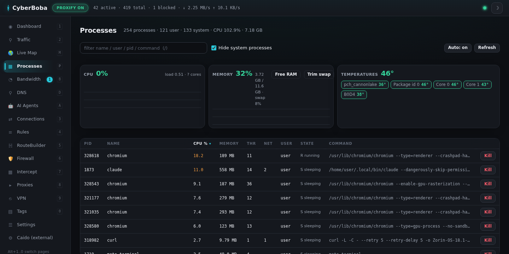
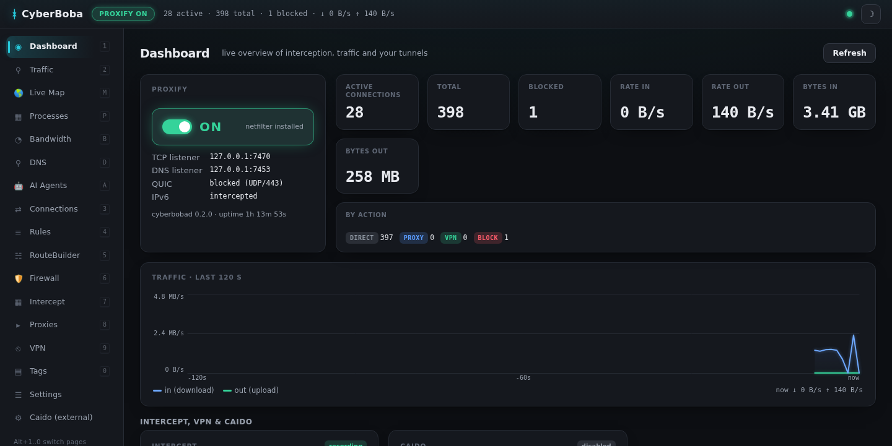

<div align="center">

# 🔱 CyberBoba Security Suite

**A Proxifier, VPN manager, intercepting HTTPS proxy, DNS ad‑blocker, per‑app firewall and network monitor — in one agent‑first daemon for Linux.**

Built so an AI agent (or you) can see and control *exactly* what every process on the machine does on the network.

[](https://github.com/cyberbobas/cyberboba-security-suite/actions/workflows/ci.yml)
[](https://go.dev)
[](#install)
[](LICENSE)
[](docs/AGENTS.md)


</div>

---

## What is this?

CyberBoba is a single Linux daemon (`cyberbobad`) that sits under all of your
outbound traffic and gives you **per‑application control and full visibility**:
route any app through a proxy, a VPN or straight out; intercept and rewrite its
HTTPS; block ads and trackers at the DNS layer; firewall it like ZoneAlarm;
watch its bandwidth; and get alerted when something starts leaking secrets or
exfiltrating data.

Every single feature is reachable three ways — **HTTP API → CLI → MCP tool** —
so it is equally usable by a human (web UI + desktop app) and by an AI agent
(91 MCP tools). That "agent‑first" design is the point: you can tell Claude
*"route Firefox through my office VPN, block trackers, and tell me if any of my
AI tools send an API key off the box"* and it can actually do it.

## The problems it solves

| Problem | How CyberBoba solves it |
|---|---|
| **Linux has no real Proxifier** — routing *specific apps* through *specific* proxies/VPNs is painful. | Transparent per‑app rules (name/path/tag/user × host/IP/port/proto) → direct / proxy / chain / VPN / block. No app reconfiguration. |
| **You can't see what your apps actually send.** | Live connection table, geographic map, per‑app bandwidth, and a built‑in MITM proxy with full request/response history. |
| **AI coding agents can leak secrets.** | A dedicated **AI Agents** control centre that recognises Claude Code, Codex, Gemini, Cursor, Copilot, aider, ollama… and flags any API key / password / token they send off the box. |
| **Ads, trackers and malware domains.** | Pi‑hole‑style DNS filtering with subscription blocklists + a live query log. |
| **Linux lacks a per‑app firewall.** | ZoneAlarm‑style application firewall: ask/allow/block per program and zone, stealth mode, host blocklist, panic "internet lock". |
| **Data exfiltration / runaway uploads.** | GlassWire‑style bandwidth meter with an **anomaly alert** when an app's upload/download spikes far above its own baseline. |
| **Automating any of the above.** | First‑class MCP server (stdio + HTTP), a `--json` CLI and a documented REST API. |

## Features

### 🧭 Proxifier (per‑app routing)
Transparent, per‑application traffic rules enforced with iptables `REDIRECT`.
Any process can be sent **direct**, through a **SOCKS5/HTTP proxy or chain**,
through a **VPN tunnel**, or **blocked** — without configuring the application.
Rules match on process name/path/tag/user, destination hostname/IP/CIDR, port
and protocol, first‑match wins. A **RouteBuilder** canvas lets you draw
multi‑hop routes (this‑machine → VPN/proxy hops → internet) visually.

### 🔐 VPN manager
WireGuard (`wg-quick`) and OpenVPN profiles with two modes — `full` (classic
default route) and `selective` (only the apps/hosts you route there use the
tunnel, several tunnels at once; needs rules, otherwise nothing uses it — the
VPN page warns and offers a one‑click switch). New profiles default to `full`.
A tunnel brought up outside cyberboba (`wg-quick up` by hand, a tray helper) is
adopted and shown as **up (external)**; Down works on it too. Kill switch,
auto‑reconnect, and **rotation** groups that cycle the active tunnel on a
timer. VPNs flagged **Autostart** come up automatically when the daemon boots.
On nftables systems cyberboba relaxes wg‑quick's anti‑spoof `preraw` drop for
loopback so transparent interception keeps working through a full tunnel.
A full tunnel that is up is drawn automatically as the first hop of every
chain that has no VPN of its own — on the Traffic map, in RouteBuilder (dashed
implicit node), in the Rules live test and `cyberboba route-test` — because
that is where the traffic physically goes.

### 🕵️ Intercepting HTTPS proxy (Caido/Burp‑style)
Built‑in MITM proxy with its own CA: request/response history with bodies and
body search, scope, **hold‑and‑edit** of live requests/responses, **match &
replace** rewrites, a **repeater**, saved sessions, and HAR/curl export. Send
any app into it with one rule (`action: intercept`) — no proxy settings in the
app. You can also record just one program (e.g. only Chromium or only Claude).

### 🔎 Passive security scanner
Every recorded flow is automatically scanned for: leaked secrets/tokens
(AWS, GCP, GitHub, Slack, Stripe, OpenAI, JWTs, private keys), credentials sent
over plain HTTP, insecure cookies (missing Secure/HttpOnly/SameSite), missing
security headers (CSP/HSTS/nosniff/X‑Frame‑Options), CORS wildcard‑with‑creds,
version disclosure and mixed content. Findings are grouped by severity.

### 🤖 AI Agents control centre  ⭐ *the headline feature*
A dedicated page/API that recognises ~18 well‑known AI CLI/coding agents
(Claude Code, Codex, Gemini, Grok, Cursor, Copilot, aider, cline, continue,
goose, ollama, …), shows which are **running**, the **API endpoints** they
contact, their **bandwidth**, and — most importantly — **any credentials/API
keys/passwords they were seen sending off the machine**. One click to monitor
all of them (transparently MITM + scan their API traffic).

### 🛡️ DNS ad/tracker/malware blocking (Pi‑hole‑style)
The built‑in DNS forwarder can load subscription blocklists (StevenBlack,
AdGuard, OISD) plus manual allow/block entries, returning NXDOMAIN or a
sinkhole address for bad domains. Every query is logged to a live monitor even
when blocking is off.

### 📊 Bandwidth monitor + anomaly alerts (GlassWire‑style)
Live per‑app download/upload speed and this‑session / today / 30‑day data
usage, persisted across restarts. An **anomaly detector** raises an alert
(toast + nav badge + API/MCP event) when an app's upload or download runs far
above its own recent baseline — catching exfiltration or a runaway process.

### 🔥 Application firewall (ZoneAlarm‑style)
Per‑program network control by zone (Trusted LAN vs Internet): off / ask /
auto / block. "Ask" holds the connection and pops a prompt; answers can be
remembered. Inbound **stealth** mode, a host blocklist enforced for every app,
and a panic **Internet Lock** switch.

### 🧰 Process & system monitor
A built‑in task manager (CPU%, memory, threads, owner, per‑pid connection
counts, safe kill), live system stats (per‑core CPU, load, memory/swap,
temperatures/fans), and one‑click **memory/swap reclaim** when the box is
sluggish.

### 🌍 Live geographic map & tags
An application‑centric world map of where your traffic goes (home → per
app→host points with ISP/bytes, one‑click block). `cyberboba run -tag NAME --
<cmd>` puts a program in a net_cls cgroup so a `tag:NAME` rule also governs its
UDP (QUIC, games, VoIP), not just TCP.

### 🚀 Autostart
A Settings toggle enables starting the daemon on system boot (systemd); on
boot the daemon comes up and Autostart‑flagged VPNs connect automatically.

## Agent‑first: API → CLI → MCP

Everything above is exposed identically through three layers:

- **HTTP API** on `127.0.0.1:7471` (`/api/...`, OpenAPI at `/api/openapi.json`).
- **CLI** `cyberboba <command>` (add `--json` for machine output).
- **MCP server** — `cyberboba mcp` over stdio, or `POST /mcp` over HTTP — with
  **91 tools**, resources and prompts. Wire it into Claude Code with:

  ```sh
  claude mcp add cyberboba -- cyberboba mcp
  ```

Humans get the embedded **web UI** (`http://127.0.0.1:7471`) and an **Electron
desktop app** (`desktop/`) with a tray icon. See `docs/AGENTS.md` first if you
are an agent.

## Screenshots

| | |
|---|---|
| **AI Agents** — who's running, where they call, and leaked secrets | **Firewall** — ZoneAlarm-style, with a "what got blocked" activity log |
|  |  |
| **Bandwidth** — per-app speed + anomaly alerts | **DNS** — Pi-hole-style ad/tracker blocking + live query log |
|  |  |
| **Intercept** — MITM history, hold/edit, passive scan | **Live Map** — where your traffic goes, per app |
|  |  |
| **Processes** — task manager + system stats | **Dashboard** — proxify state, live rates, tunnels |
|  |  |

## How it works

```
 app ──TCP──► iptables nat OUTPUT (REDIRECT) ──► cyberbobad :7470 ──► rule engine ──┬─► direct (SO_MARK bypass)
                                                                                   ├─► SOCKS5 / HTTP proxy / chain
   DNS :53 ──REDIRECT──► cyberbobad :7453 (forwarder, ip→host cache + ad‑block)     ├─► VPN (SO_MARK → policy routing table)
   app ──SOCKS5/HTTP proxy──► cyberbobad :7472 / :7473 (optional, no root needed)   ├─► intercept (MITM :8080)
                                                                                   └─► block
```

- The owning process of each connection is resolved via `/proc/net/tcp` +
  `/proc/<pid>/fd` (like `ss -p`).
- Hostnames come from the DNS cache, TLS SNI / HTTP `Host` sniffing, or the
  SOCKS5 request, so `*.example.com` rules work.
- The daemon's own sockets carry an fwmark so they are never re‑intercepted;
  selective VPNs get their own routing table selected by fwmark.

## Install

**Requirements:** Linux with iptables (legacy or nft) and `ip`; optionally
`wireguard-tools`, `openvpn`, `libnss3-tools` (for browser CA import). **Go ≥ 1.26** to build.

```sh
git clone https://github.com/<you>/cyberboba.git
cd cyberboba

make build                 # → bin/cyberbobad, bin/cyberboba
sudo make install          # → /usr/local/bin, /etc/cyberboba/config.yaml, systemd unit
sudo systemctl daemon-reload
sudo systemctl enable --now cyberboba

cyberboba status           # or open http://127.0.0.1:7471
```

To trust the intercept CA (so MITM'd HTTPS is seen without browser warnings):

```sh
sudo cyberboba intercept ca install   # system trust store + Firefox/Chromium NSS
```

**Without root** the daemon still runs (`make run-dev`): the SOCKS5 (`:7472`) and
HTTP (`:7473`) inbound proxy listeners, the rule engine, upstream proxies and the
UI all work; transparent interception and VPNs need root.

**Desktop app** (optional, needs Node/npm):

```sh
cd desktop && npm install && npm start
```

**Uninstall:** `sudo make uninstall`.

### Docker

```sh
docker build -t cyberboba .
# networking features manipulate the host firewall, so run with host net + caps:
docker run --rm --network host --cap-add=NET_ADMIN --cap-add=NET_RAW \
  -v cyberboba-etc:/etc/cyberboba -v cyberboba-lib:/var/lib/cyberboba \
  --name cyberboba cyberboba
```

Docker is handy for the UI/API/SOCKS-proxy; full transparent interception and
VPNs need the host-level access above (the daemon edits the host's iptables).

### Packages

- **Arch / AUR:** a `PKGBUILD` ships in [`packaging/aur/`](packaging/aur/PKGBUILD)
  — `makepkg -si` builds and installs the binaries, systemd unit and default config.
- **Homebrew (Linux):** [`packaging/homebrew/cyberboba.rb`](packaging/homebrew/cyberboba.rb)
  installs the binaries only (no systemd); for a full service use the AUR package
  or `sudo make install`.
- **Release tarball & AppImage:** prebuilt Linux amd64 binaries and the desktop
  AppImage are attached to each [GitHub release](https://github.com/cyberbobas/cyberboba-security-suite/releases/latest).

## Quick tour

```sh
cyberboba doctor                                  # environment checks
cyberboba rules                                   # ordered rule list
cyberboba rules test firefox example.com:443      # which rule would match?
cyberboba conns -follow                           # live connection log
cyberboba vpn import office ~/office.conf -mode selective && cyberboba vpn up office
cyberboba bandwidth                               # per-app up/down + data usage
cyberboba bandwidth alerts                        # abnormal-transfer alerts
cyberboba dns                                     # DNS filter status + query log
cyberboba ai                                      # which AI agents are running + leaks
cyberboba intercept findings                      # passive-scan findings
cyberboba autostart on                            # start on system boot
cyberboba run -tag pentest -- firefox             # rules can match "tag:pentest"
claude mcp add cyberboba -- cyberboba mcp          # expose everything to Claude Code
```

Example rules (`/etc/cyberboba/config.yaml`):

```yaml
rules:
  - {name: LAN, targets: [lan], action: direct}
  - {name: Capture browsers, apps: [firefox, chrome], ports: ["80","443"], action: intercept}
  - {name: Pentest tools, apps: ["tag:pentest"], action: proxy, proxy: socks-home}
  - {name: Work via office VPN, apps: [slack, "*teams*"], action: vpn, vpn: office}
  - {name: Kill telemetry, targets: ["*.telemetry.microsoft.com"], action: block}
  - {name: Default, action: direct}
```

See **`docs/CONFIG.md`** for every option, **`docs/API.md`** for the HTTP API,
and **`docs/AGENTS.md`** for the agent/MCP guide.

## Project layout

```
cmd/cyberbobad       daemon          internal/proxy      transparent + SOCKS5 engine, SNI/Host sniff
cmd/cyberboba        CLI             internal/upstream   SOCKS5 / HTTP CONNECT / chains / SO_MARK dialer
internal/config    YAML config     internal/netfilter  iptables chains, policy routing tables
internal/rules     rule engine     internal/dnsfwd     DNS forwarder + ad-block + ip→host cache
internal/procinfo  socket → pid    internal/vpn        WireGuard + OpenVPN backends
internal/stats     live table/SSE  internal/firewall   ZoneAlarm-style app firewall
internal/bandwidth per-app meter   internal/aiagents   AI-agent registry
internal/intercept MITM: CA, flows, hold/edit, repeater, passive scanner, HAR
internal/sysstat   CPU/mem/temps + reclaim           internal/topology   traffic map
internal/api       HTTP API        internal/mcp        MCP server (stdio + HTTP)
web/               embedded web UI (vanilla JS)      desktop/   Electron shell
```

## Windows & macOS

The full transparent experience is Linux-native. On other platforms:

- **Windows → WSL2 (recommended, full features):** run the daemon inside WSL2
  and use the UI/desktop app from Windows. See the
  **[Windows (WSL2) & macOS guide](docs/WINDOWS-WSL2.md)**.
- **macOS / native Windows → "lite" mode:** prebuilt `darwin-*` and
  `windows-amd64` binaries ship in each release and run the UI/API/MCP, upstream
  proxies, the intercepting proxy as an *explicit* proxy and DNS filtering;
  transparent interception, the app firewall and system monitors are Linux-only.

## Security & responsible use

CyberBoba is a **defensive and introspection** tool for machines **you own or
are authorised to administer**. It can intercept TLS (with a CA you install),
route traffic through proxies/VPNs, and firewall processes. Use it only on
systems and traffic you are permitted to inspect. The intercept CA private key
lives in `/etc/cyberboba/ca` — protect it like any private key. The web UI/API
bind to loopback by default; set `api.token` before exposing the API.

## Limitations

- Only TCP and DNS are intercepted transparently; other UDP goes direct (QUIC
  is blocked by default so HTTPS stays on TCP). Use a `full` VPN for all UDP.
- Interception is for locally generated traffic (`OUTPUT` chain); forwarded
  traffic from other hosts is not touched.
- Intercepted TLS is HTTP/1.1 only; pinned apps go into `intercept.passthrough`.

## License

Apache-2.0 — see [LICENSE](LICENSE).
