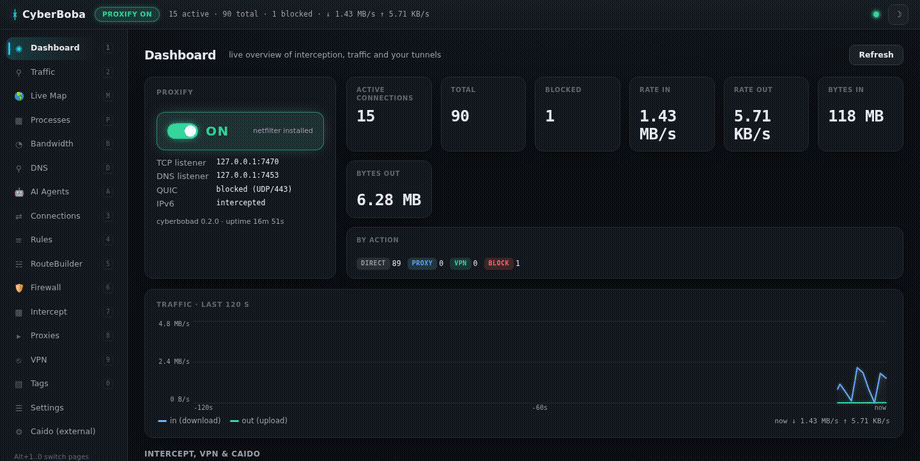

# CyberBoba Security Suite

**A Proxifier, VPN manager, intercepting HTTPS proxy, DNS ad-blocker, per-app
firewall and network monitor — in one agent-first daemon for Linux.**

[⬇ Download the latest release](https://github.com/cyberbobas/cyberboba-security-suite/releases/latest) ·
[⭐ Source on GitHub](https://github.com/cyberbobas/cyberboba-security-suite)

## Documentation

- **[HTTP API reference](API.md)** — every `/api/...` endpoint.
- **[Configuration reference](CONFIG.md)** — every `config.yaml` option.
- **[Agent / MCP guide](AGENTS.md)** — driving CyberBoba from an AI agent (92 MCP tools).

## What it does

Route any app through a proxy, VPN or straight out; intercept and rewrite its
HTTPS; block ads and trackers at the DNS layer; firewall it like ZoneAlarm;
watch its bandwidth; and get alerted when something starts leaking secrets or
exfiltrating data — all reachable via **HTTP API → CLI → MCP tool**, plus a web
UI and an Electron desktop app.

See the [README](https://github.com/cyberbobas/cyberboba-security-suite#readme)
for the full feature list, screenshots and install instructions.

---

Apache-2.0 · built for Linux · <a href="https://github.com/cyberbobas/cyberboba-security-suite">cyberbobas/cyberboba-security-suite</a>
